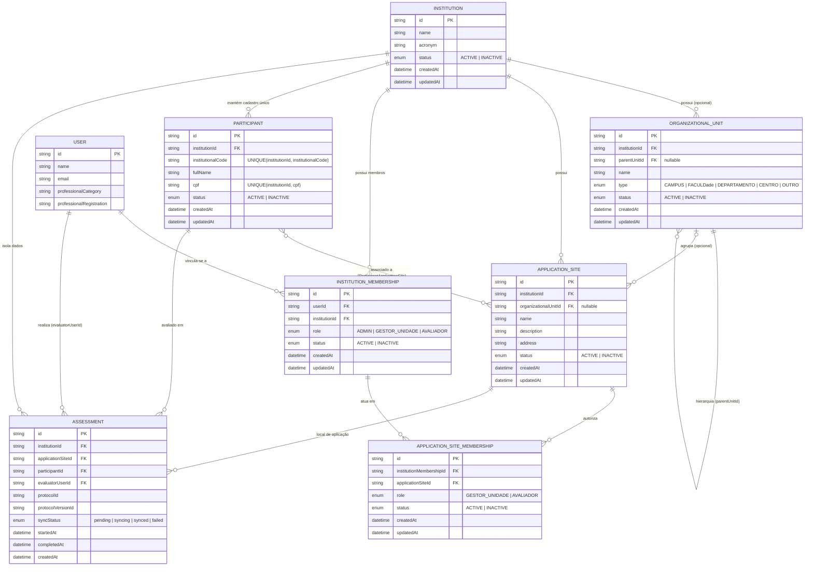

# Projeto de Endpoints da API — Ecossistema LIA (Modelo Multi-Institucional & Controle de Acesso)

Este documento especifica a arquitetura de endpoints RESTful (`/api/v1`) e as regras de negócio de **gestão multi-institucional, unidades organizacionais, unidades de aplicação e controle de acesso baseado em escopo (RBAC)** da plataforma **LIA**, respeitando todas as premissas do ecossistema:

1. **Estratégia Online-First com Fallback Local (`AsyncStorage`):**
   - Com conexão ativa e backend disponível, todas as leituras (`GET`) e envios (`POST`/`PATCH`) ocorrem diretamente na API remota.
   - O armazenamento local (`AsyncStorage`) é acionado **exclusivamente** quando não há conexão com a internet ou quando o backend está indisponível (timeout / erro `5xx`), retendo os dados como `pending` apenas até o envio para a nuvem.
2. **Catálogo, Instruções e Mídias dos Protocolos 100% Locais:**
   - Os metadados dos protocolos (`30sSTS`, `1MSTS`, `5TSTS`, `2MST`, `TUG`), textos de instruções, checklists, vídeos e imagens de posicionamento permanecem embarcados no app (`ProtocolsRepository.ts` e `test-guide/assets`).
3. **Estrutura do Questionário IVCF-20 100% Local:**
   - As 20 perguntas, opções, pesos e regras de classificação do **IVCF-20** permanecem embarcados no app (`ivcfData.ts`). A API recebe e consulta apenas as **submissões/resultados** realizados.
4. **Isolamento Multi-Institucional (`PUC`, `UFPR`, `UNESP`, etc.):**
   - Um usuário possui uma única conta global (`User`), operando com permissões estritamente isoladas por escopo (`ADMIN`, `GESTOR_UNIDADE`, `AVALIADOR`).
   - **Regra de unicidade do Avaliador (`1:1`):** Um usuário com papel `AVALIADOR` pode pertencer a **apenas uma instituição ativa** e **apenas uma unidade de aplicação ativa**. Já usuários com papéis `ADMIN` ou `GESTOR_UNIDADE` podem possuir vínculos com múltiplas instituições ou múltiplas unidades de aplicação.

---

## 1. Modelo de Relacionamento Institucional (Diagrama ER)



---

## 2. Convenções Gerais, Contexto de Escopo e Guards de Autorização

### 2.1. Headers e Contexto de Escopo
- **Base URL:** `https://api.lia.lifesystems.com.br/api/v1`
- **Autenticação:** `Authorization: Bearer <accessToken>`
- **Headers de Escopo Institucional (em rotas contextuais do App Mobile):**
  - `X-Institution-Id`: ID da instituição ativa na sessão do usuário (`inst_ufpr`, `inst_puc`, etc.).
  - `X-Application-Site-Id`: ID da unidade de aplicação ativa na sessão (`site_ufpr_lab_a`, etc.).
- **Parâmetros de Rota Explícitos (em rotas administrativas e de gestão):**
  - `/api/v1/institutions/:institutionId/...`
  - `/api/v1/application-sites/:siteId/...`

### 2.2. Pipeline de Guards e Middlewares (NestJS Clean Architecture)
Toda requisição protegida atravessa a cadeia de verificação em camadas:
1. **`AuthGuard`:** Valida a assinatura e expiração do JWT e injeta `req.user` (`id`, `email`). Nunca confia em `evaluatorUserId` enviado no corpo da requisição.
2. **`MembershipGuard`:** Verifica no banco se o usuário autenticado possui `InstitutionMembership` com `status = 'ACTIVE'` na instituição alvo (`:institutionId` ou `X-Institution-Id`).
3. **`RoleGuard`:** Valida se o papel institucional/unidade do usuário pertence ao conjunto exigido pela rota (`@Roles('ADMIN', 'GESTOR_UNIDADE', 'AVALIADOR')`).
4. **`ApplicationSiteGuard`:**
   - Se o usuário for `ADMIN` ativo na instituição, concede acesso a qualquer unidade ativa da própria instituição.
   - Se for `GESTOR_UNIDADE` ou `AVALIADOR`, exige `ApplicationSiteMembership` com `status = 'ACTIVE'` para a unidade `:siteId` / `X-Application-Site-Id` e valida que `site.institutionId === institutionId`.

### 2.3. Códigos HTTP Padronizados
| Status Code | Código de Erro (`error`) | Quando utilizar |
|---|---|---|
| `401 Unauthorized` | `UNAUTHENTICATED` | Token JWT ausente, inválido ou expirado. |
| `403 Forbidden` | `FORBIDDEN_INSTITUTION_SCOPE` / `FORBIDDEN_SITE_SCOPE` / `INSUFFICIENT_ROLE` / `FORBIDDEN_ASSESSMENT_DELETION` | Usuário autenticado sem vínculo ativo na instituição/unidade, tentativa de acesso cruzado entre instituições, ou papel insuficiente. |
| `404 Not Found` | `RESOURCE_NOT_FOUND` | Instituição, unidade, participante ou avaliação inexistente no escopo autorizado. |
| `409 Conflict` | `DUPLICATE_INSTITUTION_MEMBERSHIP` / `DUPLICATE_SITE_MEMBERSHIP` / `DUPLICATE_PARTICIPANT` | Tentativa de criar vínculo duplicado ou cadastrar participante já existente na instituição. |
| `422 Unprocessable Entity` | `LAST_ADMIN_PROTECTION` / `EVALUATOR_SINGLE_INSTITUTION_LIMIT` / `EVALUATOR_SINGLE_SITE_LIMIT` / `INACTIVE_APPLICATION_SITE` / `INACTIVE_PARTICIPANT` / `CROSS_INSTITUTION_PARTICIPANT` | Violação de regra de negócio semântica (ex.: remover o último `ADMIN` ativo da instituição, tentar vincular um `AVALIADOR` a uma segunda instituição ou segunda unidade de aplicação ativa, iniciar avaliação em unidade inativa ou para participante inativo, ou associar participante a unidade de outra instituição). |

---

## 3. Inventário Completo de Endpoints (Existentes Adaptados vs. Novos)

### 3.1. Autenticação, Perfil e Contexto de Vínculos (`/auth`, `/professionals`, `/me`)

| Método | Endpoint | Status | Papel Mínimo | Descrição |
|---|---|---|---|---|
| `POST` | `/api/v1/auth/login` | **Adaptado** | Público | Autentica o usuário e retorna tokens + perfil global + lista de vínculos institucionais e unidades ativas. |
| `POST` | `/api/v1/auth/refresh` | Mantido | Público | Renova o `accessToken` usando o `refreshToken`. |
| `POST` | `/api/v1/auth/forgot-password` | Mantido | Público | Dispara e-mail de recuperação de senha. |
| `POST` | `/api/v1/auth/reset-password` | Mantido | Público | Redefine a senha com o token de recuperação. |
| `POST` | `/api/v1/auth/logout` | Mantido | Autenticado | Invalida o refresh token da sessão atual. |
| `GET` | `/api/v1/professionals/me` | **Adaptado** | Autenticado | Retorna a identidade global do usuário (`User`) sem papel fixo global. |
| `PATCH` | `/api/v1/professionals/me` | Mantido | Autenticado | Atualiza dados cadastrais do perfil profissional. |
| `GET` | `/api/v1/me/institutions` | **Novo** | Autenticado | Lista todas as instituições às quais o usuário possui vínculo ativo (`InstitutionMembership`), incluindo seu papel em cada uma. |
| `GET` | `/api/v1/me/application-sites` | **Novo** | Autenticado | Lista as unidades de aplicação acessíveis ao usuário na instituição informada (`?institutionId=...`). |

#### Exemplo — `POST /api/v1/auth/login` (Adaptado para Multi-Instituição)
```json
{
  "accessToken": "eyJhbGciOiJIUzI1NiIs...",
  "refreshToken": "dGhpcyBpcyBhIHJlZnJlc2gg...",
  "professional": {
    "id": "prof_demo_01",
    "name": "Dr. Roberto Silva",
    "email": "dr.roberto@lia.com",
    "professionalCategory": "Fisioterapeuta",
    "professionalRegistration": "CREFITO 12345-F"
  },
  "memberships": [
    {
      "institutionId": "inst_ufpr",
      "institutionAcronym": "UFPR",
      "role": "GESTOR_UNIDADE",
      "status": "ACTIVE",
      "applicationSites": [
        { "id": "site_ufpr_lab_a", "name": "Laboratório de Biomecânica (Lab A)", "role": "GESTOR_UNIDADE" },
        { "id": "site_ufpr_amb_c", "name": "Ambulatório de Gerontologia (Amb C)", "role": "GESTOR_UNIDADE" }
      ]
    },
    {
      "institutionId": "inst_puc",
      "institutionAcronym": "PUC",
      "role": "AVALIADOR",
      "status": "ACTIVE",
      "applicationSites": [
        { "id": "site_puc_clinica_a", "name": "Clínica Escola de Fisioterapia PUC", "role": "AVALIADOR" }
      ]
    }
  ]
}
```

---

### 3.2. Gestão Institucional e Unidades Organizacionais (`/institutions`)

| Método | Endpoint | Status | Papel Permitido | Regra de Escopo |
|---|---|---|---|---|
| `GET` | `/api/v1/institutions/:institutionId` | **Novo** | `ADMIN`, `GESTOR_UNIDADE`, `AVALIADOR` | Apenas membros ativos da própria instituição (`:institutionId`). |
| `PATCH` | `/api/v1/institutions/:institutionId` | **Novo** | `ADMIN` | Apenas `ADMIN` ativo da própria instituição. |
| `GET` | `/api/v1/institutions/:institutionId/organizational-units` | **Novo** | `ADMIN`, `GESTOR_UNIDADE`, `AVALIADOR` | Lista a árvore de unidades organizacionais (`CAMPUS`, `FACULDADE`, `DEPARTAMENTO`) da instituição. |
| `POST` | `/api/v1/institutions/:institutionId/organizational-units` | **Novo** | `ADMIN` | Cria unidade organizacional (suporta `parentUnitId` da mesma instituição). |
| `PATCH` | `/api/v1/institutions/:institutionId/organizational-units/:unitId` | **Novo** | `ADMIN` | Edita ou desativa (`status: 'INACTIVE'`) unidade organizacional da própria instituição. |

---

### 3.3. Gestão de Unidades de Aplicação (`/application-sites`)

| Método | Endpoint | Status | Papel Permitido | Regra de Escopo |
|---|---|---|---|---|
| `GET` | `/api/v1/institutions/:institutionId/application-sites` | **Novo** | `ADMIN`, `GESTOR_UNIDADE`, `AVALIADOR` | `ADMIN` vê todas da instituição; `GESTOR_UNIDADE` e `AVALIADOR` veem apenas as unidades às quais possuem vínculo ativo. |
| `POST` | `/api/v1/institutions/:institutionId/application-sites` | **Novo** | `ADMIN` | Cadastra nova unidade de aplicação na instituição. |
| `PATCH` | `/api/v1/institutions/:institutionId/application-sites/:siteId` | **Novo** | `ADMIN`, `GESTOR_UNIDADE` | `ADMIN` pode editar todos os atributos e ativar/desativar; `GESTOR_UNIDADE` vinculado à unidade pode atualizar informações operacionais (`description`, `address`). |

---

### 3.4. Gestão de Vínculos e Permissões de Usuários (`/memberships`)

| Método | Endpoint | Status | Papel Permitido | Regra de Autorização e Integridade |
|---|---|---|---|---|
| `GET` | `/api/v1/institutions/:institutionId/memberships` | **Novo** | `ADMIN` | Lista todos os usuários vinculados à instituição e seus papéis. |
| `POST` | `/api/v1/institutions/:institutionId/memberships` | **Novo** | `ADMIN` | Convida/vincula usuário à instituição atribuindo `ADMIN`, `GESTOR_UNIDADE` ou `AVALIADOR`. Retorna `409 Conflict` se já houver vínculo na mesma instituição, ou `422 Unprocessable Entity` se o usuário for `AVALIADOR` e já pertencer a outra instituição ativa. |
| `PATCH` | `/api/v1/institutions/:institutionId/memberships/:membershipId` | **Novo** | `ADMIN` | Altera papel ou status do vínculo institucional. **Regras críticas:** retorna `422` (`LAST_ADMIN_PROTECTION`) se tentar revogar/desativar o último `ADMIN` ativo da instituição, ou `422` se tentar atribuir `AVALIADOR` a um usuário que já possui vínculo ativo em outra instituição. |
| `GET` | `/api/v1/application-sites/:siteId/memberships` | **Novo** | `ADMIN`, `GESTOR_UNIDADE` | Lista os usuários vinculados à unidade de aplicação (`:siteId`). |
| `POST` | `/api/v1/application-sites/:siteId/memberships` | **Novo** | `ADMIN`, `GESTOR_UNIDADE` | `ADMIN` pode vincular `GESTOR_UNIDADE` ou `AVALIADOR`; `GESTOR_UNIDADE` daquela unidade pode vincular **exclusivamente** `AVALIADOR` (`403 Forbidden` se tentar atribuir `ADMIN` ou `GESTOR_UNIDADE`). **Regra de unicidade do Avaliador:** retorna `422 Unprocessable Entity` se o `AVALIADOR` já estiver vinculado a outra unidade de aplicação ativa. |
| `PATCH` | `/api/v1/application-sites/:siteId/memberships/:siteMembershipId` | **Novo** | `ADMIN`, `GESTOR_UNIDADE` | Permite desativar (`status: 'INACTIVE'`) o vínculo de um avaliador com a unidade, preservando todas as avaliações históricas já realizadas por ele. |

---

### 3.5. Gestão de Participantes Multi-Institucional (`/participants`)

| Método | Endpoint | Status | Papel Permitido | Regra de Escopo e Compartilhamento |
|---|---|---|---|---|
| `GET` | `/api/v1/participants` | **Adaptado** | `ADMIN`, `GESTOR_UNIDADE`, `AVALIADOR` | Filtra por `X-Institution-Id`: `ADMIN` lista todos da instituição; `GESTOR_UNIDADE` e `AVALIADOR` listam apenas participantes associados às suas unidades autorizadas (ou filtrados por `?applicationSiteId=`). |
| `POST` | `/api/v1/participants` | **Adaptado** | `ADMIN`, `GESTOR_UNIDADE`, `AVALIADOR` | Cria registro único na instituição (`institutionId`) e associa à unidade ativa (`X-Application-Site-Id`). Se o participante já existir na instituição (`cpf` ou `institutionalCode`), **não duplica**: apenas associa à unidade caso ainda não esteja associado. |
| `POST` | `/api/v1/participants/:id/application-sites` | **Novo** | `ADMIN`, `GESTOR_UNIDADE`, `AVALIADOR` | Associa um participante existente da instituição a outra unidade de aplicação autorizada da **mesma** instituição. Retorna `422 CROSS_INSTITUTION_PARTICIPANT` se as instituições divergirem. |
| `GET` | `/api/v1/participants/:id` | **Adaptado** | `ADMIN`, `GESTOR_UNIDADE`, `AVALIADOR` | Retorna a ficha cadastral se o participante pertencer à instituição e unidade autorizada do usuário. |
| `PATCH` | `/api/v1/participants/:id` | **Adaptado** | `ADMIN`, `GESTOR_UNIDADE`, `AVALIADOR` | Atualiza informações cadastrais permitidas dentro do escopo autorizado. |
| `GET` | `/api/v1/participants/:id/assessments` | **Adaptado** | `ADMIN`, `GESTOR_UNIDADE`, `AVALIADOR` | Retorna o histórico institucional do participante (usado pela Ficha do Participante para calcular **Avaliações Pendentes**). |

---

### 3.6. Avaliações Funcionais, IVCF-20, Sincronização e Indicadores (`/assessments`, `/questionnaires`, `/sync`, `/dashboard`)

| Método | Endpoint | Status | Papel Permitido | Regras Obrigatórias de Avaliação (Seção 6) |
|---|---|---|---|---|
| `POST` | `/api/v1/assessments` | **Adaptado** | `ADMIN`, `GESTOR_UNIDADE`, `AVALIADOR` | 1. Extrai `evaluatorUserId` exclusivamente do JWT (`AuthGuard`), ignorando qualquer valor enviado pelo frontend.<br>2. Valida que `participant.institutionId === site.institutionId === institutionId`.<br>3. Exige vínculo ativo do avaliador na unidade.<br>4. Bloqueia (`422`) se a unidade ou o participante estiver `INACTIVE`. |
| `GET` | `/api/v1/assessments` | **Adaptado** | `ADMIN`, `GESTOR_UNIDADE`, `AVALIADOR` | `ADMIN` consulta todas as unidades da instituição; `GESTOR_UNIDADE` e `AVALIADOR` consultam apenas avaliações das unidades às quais estão vinculados. |
| `GET` | `/api/v1/assessments/:id` | **Adaptado** | `ADMIN`, `GESTOR_UNIDADE`, `AVALIADOR` | Detalhes completos da avaliação (respeitando isolamento institucional e de unidade). |
| `DELETE` | `/api/v1/assessments/:id` | **Novo** | `ADMIN`, `GESTOR_UNIDADE` | **Bloqueado (`403 FORBIDDEN_ASSESSMENT_DELETION`) para `AVALIADOR`** em avaliações finalizadas. Mesmo quando um avaliador é desvinculado, suas avaliações permanecem preservadas. |
| `GET` | `/api/v1/assessments/:id/export-csv` | **Adaptado** | `ADMIN`, `GESTOR_UNIDADE`, `AVALIADOR` | Exporta `.csv` das amostras inerciais 60 Hz dentro do escopo autorizado. |
| `POST` | `/api/v1/questionnaires/ivcf-20/submissions` | **Adaptado** | `ADMIN`, `GESTOR_UNIDADE`, `AVALIADOR` | Aplica as mesmas 8 validações de integridade de `POST /api/v1/assessments`. |
| `POST` | `/api/v1/sync/batch` | **Adaptado** | `ADMIN`, `GESTOR_UNIDADE`, `AVALIADOR` | Sincroniza o lote offline validando `institutionId`, `applicationSiteId` e atribuindo `evaluatorUserId` a partir do token. |
| `GET` | `/api/v1/dashboard/metrics` | **Adaptado** | `ADMIN`, `GESTOR_UNIDADE`, `AVALIADOR` | `ADMIN`: indicadores consolidados de todas as unidades da instituição (ou filtrados por `?applicationSiteId=`). `GESTOR_UNIDADE` / `AVALIADOR`: indicadores operacionais restritos às suas unidades vinculadas. |

---

## 4. Estratégia de Migrations e Compatibilidade com Dados Legados

Para preservar os participantes e avaliações já existentes sem perda de dados:

1. **Passo 1 — Criação das Tabelas de Estrutura Institucional:**
   - Criar tabelas `institutions`, `organizational_units`, `application_sites`, `institution_memberships`, `application_site_memberships` e tabela associativa `participant_application_sites`.
2. **Passo 2 — Seed Institucional Padrão (Default Institution & Site):**
   - Inserir instituição padrão de migração (ex.: `inst_ufpr` — UFPR) e unidade padrão (`site_ufpr_lab_a` — Laboratório de Biomecânica).
3. **Passo 3 — Adição de Colunas Nullable e Backfill:**
   - Adicionar `institution_id`, `institutional_code` e `status` (`DEFAULT 'ACTIVE'`) em `participants`.
   - Preencher registros legados com `institution_id = 'inst_ufpr'` e vincular todos os participantes legados à unidade padrão em `participant_application_sites`.
   - Adicionar `institution_id`, `application_site_id`, `evaluator_user_id` e `protocol_version_id` em `assessments`, copiando `professional_id -> evaluator_user_id` e atribuindo `inst_ufpr` / `site_ufpr_lab_a`.
4. **Passo 4 — Aplicação de Constraints `NOT NULL` e Índices Compostos:**
   - Tornar `institution_id` obrigatório (`NOT NULL`) em `participants` e `assessments`.
   - Criar constraints únicas `UNIQUE(institution_id, institutional_code)`, `UNIQUE(user_id, institution_id)` em `institution_memberships` e `UNIQUE(institution_membership_id, application_site_id)` em `application_site_memberships`.
5. **Compatibilidade no App Mobile (`ParticipantsRepository` e `AssessmentsRepository`):**
   - Registros previamente salvos no `AsyncStorage` sem `institutionId` ou `applicationSiteId` são enriquecidos automaticamente na leitura (`getRawList()`) com o escopo institucional padrão (`inst_ufpr` / `site_ufpr_lab_a`).
