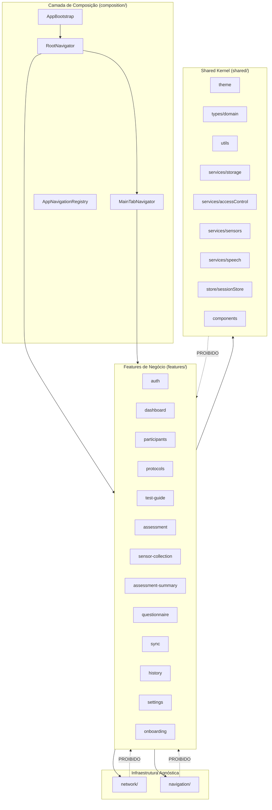

# Arquitetura do LIA Mobile (Multi-Institucional & Controle de Acesso)

Este documento descreve as decisões arquiteturais, modelos de domínio multi-institucionais, controle de acesso baseado em escopo (RBAC), fluxos de execução e regras de isolamento implementadas no **LIA Mobile**, seguindo a filosofia do **Feature-Sliced Design (FSD)**.

---

## 1. Diagrama de Módulos e Dependências

---

## 2. Arquitetura Multi-Institucional e Controle de Acesso (RBAC)

O ecossistema LIA suporta múltiplas instituições de ensino, pesquisa e saúde (`UFPR`, `PUC`, `UNESP`, etc.) com isolamento estrito de dados:

### 2.1. Entidades de Domínio (`src/app/shared/types/domain.ts`)
- **`Institution`**: Instituição cadastrada no LIA (`id`, `name`, `acronym`, `status`).
- **`OrganizationalUnit`**: Divisão organizacional opcional e hierárquica (`institutionId`, `parentUnitId`, `name`, `type`, `status`).
- **`ApplicationSite`**: Local físico de realização dos protocolos (`institutionId`, `organizationalUnitId`, `name`, `description`, `address`, `status`).
- **`InstitutionMembership`**: Vínculo de um usuário com uma instituição (`userId`, `institutionId`, `role`, `status`).
- **`ApplicationSiteMembership`**: Vínculo de um usuário (`GESTOR_UNIDADE` ou `AVALIADOR`) com uma unidade de aplicação (`institutionMembershipId`, `applicationSiteId`, `role`, `status`).
- **`Participant`**: Vinculado à instituição (`institutionId`, `institutionalCode`) e associado a uma ou mais unidades (`applicationSiteIds`) da mesma instituição sem duplicação de prontuário.
- **`Assessment`**: Vinculada obrigatoriamente a `institutionId`, `applicationSiteId`, `participantId`, `evaluatorUserId` e `protocolVersionId`.

### 2.2. Papéis e Escopos (`AccessControlService.ts`)
1. **`ADMIN` (Escopo Institucional):**
   - Gerencia dados da própria instituição, unidades organizacionais, unidades de aplicação e vínculos de usuários.
   - Proteção de integridade: é proibido remover ou desativar o último `ADMIN` ativo de uma instituição (`HTTP 422 LAST_ADMIN_PROTECTION`).
   - Consulta participantes, avaliações e indicadores consolidados de todas as unidades da sua instituição, sem acesso a outras instituições.
2. **`GESTOR_UNIDADE` (Escopo de Unidade de Aplicação):**
   - Opera sobre uma ou mais unidades às quais possui vínculo ativo.
   - Pode vincular ou desativar usuários exclusivamente com o papel `AVALIADOR` nas unidades sob sua gestão (`HTTP 403` se tentar atribuir `ADMIN` ou `GESTOR_UNIDADE`).
   - Cadastra e consulta participantes, avaliações e indicadores operacionais de suas unidades.
3. **`AVALIADOR` (Escopo Estrito 1:1 — 1 Instituição e 1 Unidade de Aplicação):**
   - Pode pertencer a **apenas uma instituição ativa** e **apenas uma unidade de aplicação ativa** (`HTTP 422` caso haja tentativa de vinculá-lo a uma segunda instituição ou segunda unidade ativa).
   - Consulta participantes e realiza avaliações exclusivamente na sua unidade autorizada.
   - Não gerencia instituições, unidades ou vínculos de outros usuários e não pode excluir avaliações finalizadas (`HTTP 403 FORBIDDEN_ASSESSMENT_DELETION`).

---

## 3. Regras Estritas de Dependência

| Origem | Destino | Regra | Justificativa |
|---|---|---|---|
| Feature | `network/` | **Permitido** (via contrato público) | Features realizam chamadas HTTP especializadas usando o cliente agnóstico. |
| Feature | `navigation/` | **Permitido** (via API pública) | Features utilizam opções, hooks e componentes genéricos de navegação. |
| Feature | Outra Feature | **Apenas via contrato público** | Módulos são desacoplados; importações internas diretas são proibidas. |
| `network/` | Features | **PROIBIDO** | Infraestrutura não conhece entidades como `Participant`, `Assessment` ou rotas. |
| `navigation/` | Features | **PROIBIDO** | Navegação não conhece telas ou regras de negócio; recebe componentes por composição. |
| `shared/` | Features | **PROIBIDO** | Kernel compartilhado é agnóstico aos domínios das features. |
| `composition/` | Features, Network, Navigation, Shared | **Permitido** | Ponto de junção e injeção de dependências do aplicativo. |

---

## 4. Arquitetura da Coleta de Sensores e Conteúdo Local

1. **Frequência-Alvo de 60 Hz (`ExpoSensorService`):**
   - Configura `Accelerometer.setUpdateInterval(16)` e `Gyroscope.setUpdateInterval(16)`.
2. **Protocolos Funcionais e Questionário IVCF-20 Embarcados Localmente:**
   - As instruções, mídias e imagens dos protocolos funcionais (`30sSTS`, `1MSTS`, `5TSTS`, `TUG`, `2MST`) e a árvore de 20 perguntas e pontuação do `IVCF-20` residem localmente no aplicativo.
3. **Estratégia Online-First com Fallback no `AsyncStorage`:**
   - O `AsyncStorage` atua exclusivamente como contingência quando não há conectividade ou quando o backend está indisponível.
