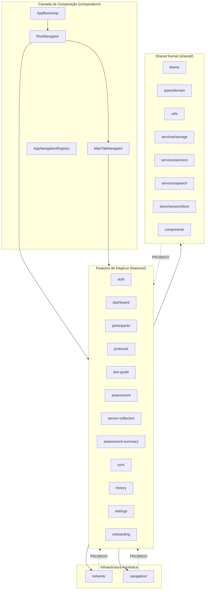
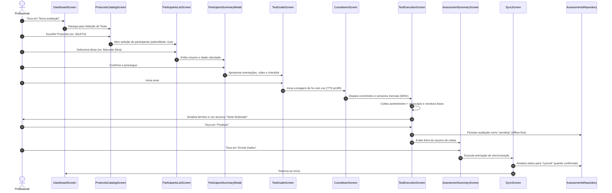

# Arquitetura do LIA Mobile

Este documento descreve as decisões arquiteturais, modelos de domínio, fluxos de execução e regras de isolamento implementadas no **LIA Mobile**, seguindo a filosofia do **Feature-Sliced Design (FSD)** e a arquitetura de referência do **Pressão Fácil**.

---

## 1. Diagrama de Módulos e Dependências



---

## 2. Regras Estritas de Dependência

| Origem | Destino | Regra | Justificativa |
|---|---|---|---|
| Feature | `network/` | **Permitido** (via contrato público) | Features realizam chamadas HTTP especializadas usando o cliente agnóstico. |
| Feature | `navigation/` | **Permitido** (via API pública) | Features utilizam opções, hooks e componentes genéricos de navegação. |
| Feature | Outra Feature | **Apenas via contrato público** | Módulos são desacoplados; importações internas diretas são proibidas. |
| `network/` | Features | **PROIBIDO** | Infraestrutura não conhece entidades como `Participant`, `Assessment` ou rotas. |
| `navigation/` | Features | **PROIBIDO** | Navegação não conhece telas ou regras de negócio; recebe componentes por composição. |
| `shared/` | Features | **PROIBIDO** | Kernel compartilhado é agnóstico aos domínios das features. |
| `composition/` | Features, Network, Navigation, Shared | **Permitido** | Ponto de junção e injeção de dependências do aplicativo. |

---

## 3. Fluxo de uma Avaliação Motora



---

## 4. Arquitetura da Coleta de Sensores

1. **Frequência-Alvo de 60 Hz:**
   - O serviço `ExpoSensorService` configura `Accelerometer.setUpdateInterval(16)` e `Gyroscope.setUpdateInterval(16)`.
   - O aplicativo calcula timestamps reais para cada amostra sem assumir uma taxa estritamente invariável do SO.
2. **Contrato de Amostra (`SensorSample`):**
   ```typescript
   export type SensorSample = {
     timestamp: number;
     accelerationX: number;
     accelerationY: number;
     accelerationZ: number;
     gyroscopeX: number;
     gyroscopeY: number;
     gyroscopeZ: number;
   };
   ```
3. **Simulador de Desenvolvimento (`MockSensorService`):**
   - Em emuladores ou dispositivos sem sensores físicos, um gerador periódico oscilatório simula as oscilações biomotoras do teste sentar-e-levantar.

---

## 5. Estratégia Offline-First e Sincronização

1. **Persistência Local Obrigatória Pré-Envio:**
   - Antes de qualquer tentativa de transmissão para a nuvem, a avaliação é persistida localmente no repositório com `syncStatus: 'pending'`.
2. **Ciclo de Estados de Sincronização:**
   - `pending`: Coleta finalizada e armazenada no dispositivo.
   - `syncing`: Pacote em trânsito com o adaptador `LiaSyncAdapter`.
   - `synced`: Confirmação positiva recebida do servidor remoto.
   - `failed`: Falha de rede ou timeout; registro permanece íntegro para retentativa manual.
3. **Desacoplamento do Backend Remoto:**
   - A comunicação é mediada pelo cliente HTTP genérico em `network/client/HttpClient.ts`.
   - Nenhuma URL falsa ou credencial fictícia foi acoplada à infraestrutura de rede.
